<div align="center">



**Full Stack PHP developer · Laravel · MySQL** — Santa Cruz de la Sierra, Bolivia 🇧🇴

🟢 **Open to freelance projects with international clients and remote Laravel roles.**

</div>

---

## 👋 Hi, I'm Andrés

I build complete web systems, from the database to the UI: sales and inventory platforms, admin panels and REST backends in PHP/Laravel. I care about the details that fail silently in production: race conditions, permissions, tests that actually exercise the database.

🇪🇸 _Soy Andrés, desarrollador Full Stack PHP (Laravel · MySQL). Construyo sistemas de ventas e inventario, paneles de administración y backends en PHP/Laravel. Disponible para proyectos freelance._

```php
<?php

namespace jandrescodes\Profile;

class FullStackDeveloper
{
    public string $name     = 'Andrés';
    public string $role     = 'PHP FullStack Developer';
    public string $degree   = 'Ingeniero de Sistemas';
    public string $location = 'Bolivia 🇧🇴';
    public string $org      = '@WorkTeam01';

    /** @var string[] */
    public array $currentFocus = [
        'Laravel 12: Service Layer, Repository Pattern, Jobs y Queues',
        'Spec-Driven Development con Claude Code (sdd-toolkit)',
        'Testing con PHPUnit, Pest y Playwright',
        'CI/CD con GitHub Actions',
    ];

    /** @var string[] */
    public array $values = [
        'Código limpio sobre código rápido',
        'Patrones de diseño como herramienta, no como religión',
    ];
}
```

---

## 💼 Featured projects

<table>
<tr>
<td width="33%" valign="top">

### 🛒 [shopping-list](https://github.com/jandrescodes/shopping-list)

Family shopping-list PWA, no accounts needed. Laravel 12 REST API, Alpine.js, HTTP polling sync with per-field conflict resolution. Tested with Pest and Playwright; CI and deploy on GitHub Actions.

**[▶ Live demo](https://paleturquoise-llama-677683.hostingersite.com/)**


</td>
<td width="33%" valign="top">

### 🧭 [sdd-toolkit](https://github.com/jandrescodes/sdd-toolkit)

The full Spec-Driven Development flow (8 phases, EARS notation) as a Claude Code plugin and opencode skills. Versioned, with its own quality gate. Built with its own flow.


</td>
<td width="33%" valign="top">

### 🌱 [agroscan](https://github.com/jandrescodes/agroscan)

AI pest diagnosis for small farmers in Santa Cruz, Bolivia. Photo in, diagnosis out, adapted to the current weather. Laravel + Gemini Vision + Open-Meteo. Built for the **Build With AI 2026** hackathon (GDG Santa Cruz).


</td>
</tr>
</table>

**Also, in plain PHP (no framework):**

- 🏗️ [php-mvc-admin-starter](https://github.com/jandrescodes/php-mvc-admin-starter): production-ready admin panel (AdminLTE 4) with auth, granular RBAC, email invitations, audit log, dark mode.
- 🛒 [Sistema_de_Ventas_PHP](https://github.com/WorkTeam01/Sistema_de_Ventas_PHP): POS + inventory with RBAC, atomic transactions, PDF invoices and PHPUnit 11.
- 🏨 [HotelFlow](https://github.com/WorkTeam01/HotelFlow): hotel management (reception, rooms, services, sales, inventory) with a ledger-style guest folio.
- 🔐 [Encriptacion_PHP](https://github.com/jandrescodes/Encriptacion_PHP): custom-MVC auth system with account lockout, remember-me, password recovery and CI.

> 🏢 **[@WorkTeam01](https://github.com/WorkTeam01)** is the organization where I lead open source and business-oriented projects. Some work is private for client confidentiality.

---

## 🛠️ Stack

<div align="center">


</div>

---

## 🤝 Let's connect

<div align="center">

[](https://www.linkedin.com/in/jandresml/)
[](https://x.com/jandrescodes)
[](https://cyan-lobster-814091.hostingersite.com/)
[](https://github.com/WorkTeam01)
[](mailto:jandrespb4@gmail.com)


</div>

---

<div align="center">


**"El código limpio siempre parece que fue escrito por alguien a quien le importa."** – Robert C. Martin

</div>
